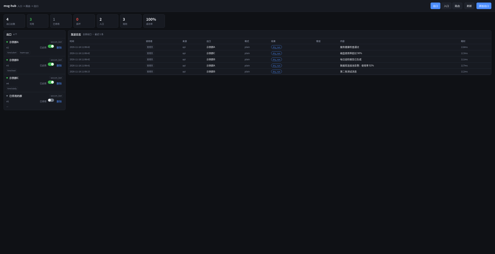
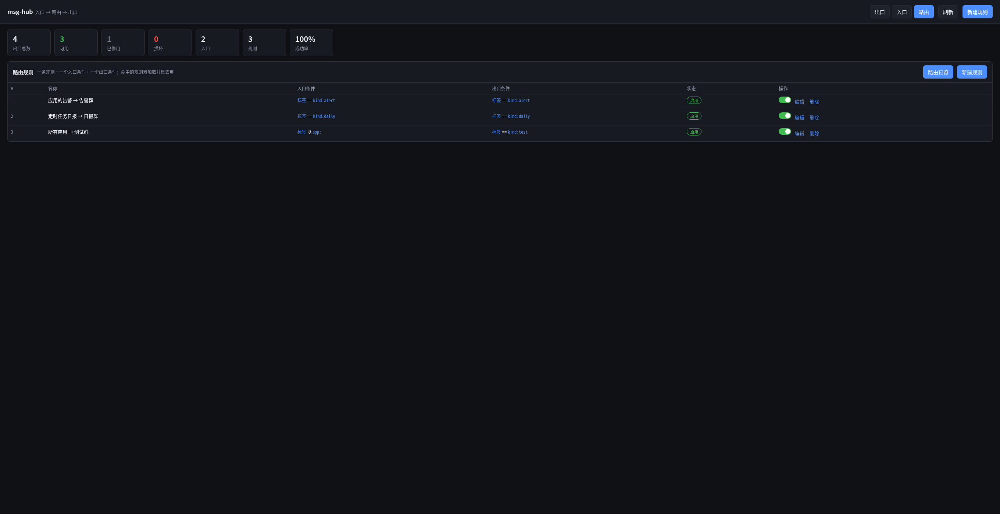

# msg-hub

多入口、按规则路由的**消息发送 MCP 服务**：调用方只拿一把 token 发消息，**投递到哪些出口完全由服务端决定**。

一句话概括：**调用方只提供 token 和正文，不关心发到哪个群** —— 出口由「入口标签 + 路由规则」算出来。

```
                      ┌──────────────── msg-hub ─────────────────┐
pi-box / 定时任务 /  → │ /mcp   MCP Streamable HTTP               │
curl / 脚本          → │ /api   REST                              │
                      │                                          │
                      │ ① 入口 Entry    token + 标签（谁在发）    │
                      │ ② 路由 Rule     入口条件 + 出口条件       │
                      │ ③ 出口 Channel  企微群机器人 / 邮箱 + 标签 │
                      │                                          │
                      │ tools    工具契约（两个前端共用一份）      │
                      │ routing  条件匹配 / 规则累加 / 去重        │
                      │ service  逐出口投递 / 聚合 / 限流 / 审计   │
                      │ store    state.json（出口 + 入口 + 规则） │
                      └───────────────┬──────────────────────────┘
                                      │ 子进程 + stdin JSON
                      ┌───────────────┴──────────────┐
                      │ types/wecom_bot  → 企微群机器人 webhook
                      │ types/email      → SMTP
                      └──────────────────────────────┘
```

一次发送的判定过程：

```
消息进来（只有 token + 正文）
   → 认证得到入口 Entry（带标签）
   → 遍历所有启用的规则，命中的规则把出口并进结果集
   → 并集去重
   → 逐个出口发送，聚合结果（sent / skipped / failed）
```

关键性质：**规则之间是累加关系，没有优先级**。加一条新规则不会改变已有规则的行为，
不会出现「改了 A 导致 B 失效」这种路由陷阱。

## 特性

- **入口 / 路由 / 出口三层**：调用方只持 token；出口靠标签 + 规则匹配，**群改名、换实现都不影响调用方**
- **调用方无法指定出口**：token 传 `channel` 会被拒（403）——「发到哪」这件事只有服务端说了算
- **一对多扇出**：一次发送可命中多个出口（并集去重），逐出口返回结果；单个出口停用/不兼容只记为 `skipped`，不会拖垮整个请求
- **标签表达式**：`exact` / `contains` / `prefix` / `suffix`，配合 `key:value` 标签可做层级匹配（`app:` 捞出所有应用）
- **渠道增删改查**：`channel_create` / `channel_update` / `channel_delete` / `channel_list` / `channel_get`
- **统一发送**：`send_message` 支持纯文本 / markdown，企微支持 `@成员`、`@所有人`（需出口授权）
- **类型内省**：每种渠道类型带 `manifest.json` + JSON Schema，AI 建渠道前先查 schema，不会瞎填字段
- **进程隔离的插件模型**：一个类型 = 一个目录 = 一个 `send_msg.py`，崩了也不影响主程序
- **单一状态文件**：出口、凭据、护栏、入口、路由规则全在 `state.json`（`0600`）——一次原子写 = 不会出现「有渠道无配置」的烂数据，接口返回一律打码
- **防误发**：名称模糊匹配到多个时**报错并给候选**，绝不猜；`dry_run` 先校验；`@all` 需显式开启；单渠道限流
- **审计日志**：每条发送（含 dry_run、失败）写 `logs/YYYY-MM-DD.jsonl`，`message_logs` 可查
- **两种部署形态**：HTTP 服务（compose，供外部系统调用）/ **stdio 子进程（零依赖，直接塞进 pi-box 等宿主）**
- **自带 Dashboard**：HTTP 形态带一个单页看板（出口 / 入口 / 路由 三个页签），能手工启停增删、编辑标签与规则，并带「路由预览」看某入口会发到哪些出口
- **零外部依赖**：核心只用标准库（无 pip 包），没有数据库、没有 MQ
- **工具契约只写一遍**：stdio 与 HTTP 两个前端共用 `msg_hub/tools.py` 里的同一份定义，不会各自漂移

## 两种部署形态

| 形态 | 入口 | 依赖 | 鉴权 | 适用 |
|---|---|---|---|---|
| **stdio（推荐集成 pi-box）** | `python3 src/msg_hub/stdio.py` | **仅 python3** | 不需要（宿主拉起，天然在信任边界内） | 由宿主（pi-box / Claude Desktop）作为子进程拉起 |
| HTTP 服务 | `python3 -m msg_hub`（compose） | `pip install .[http]` | **必须**配管理员密码，没配拒绝启动 | 多系统共用、用 curl / 定时任务调用 |

stdio 模式手写实现了 MCP 的 `initialize` / `tools/list` / `tools/call`，不依赖 mcp SDK，所以只要有 python3 就能跑（pi-box 镜像里就是 `python3 3.11`、无 pip）。数据目录默认 `~/.msg-hub`，可用 `MSG_HUB_DATA_DIR` 指定。

手工验证：

```bash
echo '{"jsonrpc":"2.0","id":1,"method":"initialize","params":{"protocolVersion":"2025-11-25","capabilities":{},"clientInfo":{"name":"t","version":"0"}}}' \
  | python3 src/msg_hub/stdio.py
```

## 快速开始（HTTP 服务）

```bash
cp .env.example .env
# 必填：MSG_HUB_ADMIN_PASSWORD=...（openssl rand -hex 24）
#   没填的话 HTTP 服务会**直接拒绝启动**（能发消息/删渠道的服务不允许裸奔）
# 国内构建慢可设 PIP_INDEX_URL=https://mirrors.aliyun.com/pypi/simple

podman compose up -d --build     # 或 docker compose up -d --build
curl -s localhost:8788/health | jq
```

启动时的鉴权自检：

```text
$ MSG_HUB_ADMIN_PASSWORD= python -m msg_hub
[msg-hub] 拒绝启动：鉴权未配置

[错误] HTTP 模式必须配置管理员密码 MSG_HUB_ADMIN_PASSWORD（Basic 认证用）。
        生成：openssl rand -hex 24
        ...
```

如果 `.env` 里写了但没导进环境变量，错误信息会直接指出这个坑：

```text
[错误] 检测到 /path/.env 里设置了 MSG_HUB_ADMIN_PASSWORD，但当前进程的环境变量里没有它——
       服务不会自动读 .env，请用 `set -a; . ./.env; set +a` 导出，或交给 compose / systemd 注入。
```

### 新建一个企业微信群渠道

1. 在企业微信群里「添加群机器人」，拿到 webhook 地址
   `https://qyapi.weixin.qq.com/cgi-bin/webhook/send?key=xxxxxxxx`
2. 创建渠道（REST）：

```bash
curl -s -X POST localhost:8788/api/channels \
  -u "admin:$MSG_HUB_ADMIN_PASSWORD" \
  -H 'Content-Type: application/json' \
  -d '{
        "name": "运维告警群",
        "type": "wecom_bot",
        "settings": {"webhook_key": "xxxxxxxx"},
        "options": {"allow_mention_all": true, "rate_limit_per_min": 30},
        "tags": ["kind:alert", "team:ops"]
      }' | jq
```

3. 建入口（拿到 token，明文只返回一次）：

```bash
curl -s -X POST localhost:8788/api/entries \
  -u "admin:$MSG_HUB_ADMIN_PASSWORD" \
  -H 'Content-Type: application/json' \
  -d '{"name": "监控平台", "tags": ["app:monitor", "kind:alert"]}' | jq
# → {"ok":true,"entry":{... ,"secret":"mh_2f8a1c…"}}
```

4. 建路由规则（入口标签 `app:` 开头 → 出口标签 `kind:alert`）：

```bash
curl -s -X POST localhost:8788/api/rules \
  -u "admin:$MSG_HUB_ADMIN_PASSWORD" \
  -H 'Content-Type: application/json' \
  -d '{
        "name": "监控平台的告警 → 运维群",
        "entry":    {"field": "tag", "op": "prefix", "value": "app:"},
        "outbound": {"field": "tag", "op": "exact",  "value": "kind:alert"}
      }' | jq
```

5. 用 token 发消息 —— **只传正文，不传 channel**：

```bash
curl -s -X POST localhost:8788/api/send \
  -H "Authorization: Bearer $MSG_HUB_TOKEN" \
  -H 'Content-Type: application/json' \
  -d '{"text": "**磁盘占用 92%**", "format": "markdown"}' | jq
# → {"ok":true,"routed":true,"counts":{"total":1,"sent":1,"skipped":0,"failed":0},
#    "results":[{"channel":{"id":1,"name":"运维告警群"},"status":"sent",...}],
#    "matched_rules":[{"id":1,"name":"监控平台的告警 → 运维群"}]}
```

6. 不确定会发到哪？先预览（不发送）：

```bash
curl -s "localhost:8788/api/route/preview?entry=监控平台" \
  -u "admin:$MSG_HUB_ADMIN_PASSWORD" | jq
# 返回 outbounds（命中的出口）+ trace（每条规则的判定明细）
```

### 新建一个邮箱渠道

```bash
curl -s -X POST localhost:8788/api/channels \
  -u "admin:$MSG_HUB_ADMIN_PASSWORD" \
  -H 'Content-Type: application/json' \
  -d '{
        "name": "我的QQ邮箱",
        "type": "email",
        "settings": {
          "smtp_host": "smtp.qq.com",
          "smtp_port": 465,
          "security": "ssl",
          "username": "me@qq.com",
          "password": "QQ邮箱授权码，不是登录密码",
          "to": ["me@qq.com"],
          "subject_prefix": "[msg-hub] "
        }
      }' | jq
```

> Gmail 在国内直连大概率不通，可在 settings 里加 `"socks5_proxy": "socks5://PROXY_HOST:PORT"`。

## 接入 pi-box（stdio，推荐）

pi-box 的 MCP 是"子进程 + stdio"模型，所以 msg-hub 用 stdio 形态最省事：**不需要额外容器、不需要端口、不需要 token**。

### 1. 把源码只读挂载进 pi-box 容器

在 pi-box 的 `docker-compose.yml` 里加一行（`../msg-hub` 指向本仓库）：

```yaml
    volumes:
      - ./workspace:/workspace
      - ./agent-home:/home/agent
      - ../msg-hub:/opt/msg-hub:ro     # ← msg-hub 源码（只读）
```

### 2. 注册 MCP

界面「系统设置 → MCP → 新增」，或直接调 API：

```bash
curl -s -X POST http://127.0.0.1:8790/api/mcp \
  -H 'Content-Type: application/json' \
  -d '{
    "name": "msg-hub",
    "config": {
      "command": "python3",
      "args": ["/opt/msg-hub/src/msg_hub/stdio.py"],
      "env": { "MSG_HUB_DATA_DIR": "/home/agent/.pi-boxd/msg-hub" },
      "description": "消息渠道中心：渠道增删改查 + 统一发送（企微群 / 邮箱）",
      "exposure": "direct",
      "timeout": 60
    }
  }'

# 验证（走真实 stdio 握手）
curl -s -X POST http://127.0.0.1:8790/api/mcp/test -H 'Content-Type: application/json' -d '{"name":"msg-hub"}'
```

> 数据目录务必用绝对路径（`/home/agent/.pi-boxd/msg-hub`）：子进程的 cwd 是 `/workspace`，相对路径会写错位置。放在 `agent-home` 下可随现有备份策略持久化。

### 3. 给角色授权

在该助理/Agent 的 `.md` frontmatter 加 `mcps: [msg-hub]`（或界面里勾选）。

### 4. 用起来

跟助理说："把运维告警群加进来，webhook key 是 xxx"，然后"往运维告警群发条消息：磁盘告警"。

> ⚠️ **容器代理坑**：podman 会把宿主机的 `http_proxy`（如 `127.0.0.1:11001`）注入容器，而容器内并不存在该代理。wecom 插件默认**忽略环境代理**，只有显式配置 `http_proxy` 时才走代理——所以无需额外处理。若确实要经代理访问企业微信，在渠道 `settings` 里填 `http_proxy`。

### HTTP 服务形态（可选）

如果还想让别的系统（bash、定时任务、其他平台）用 REST 调用，再额外跑 compose 版，并通过 MCP HTTP 传输接入：

```yaml
# msg-hub/compose.yaml
services:
  msg-hub:
    networks: [pi-box-net]
networks:
  pi-box-net:
    external: true
    name: pi-box_default
```

```json
{
  "mcpServers": {
    "msg-hub-http": {
      "url": "http://msg-hub:8788/mcp",
      "headers": { "Authorization": "Bearer ${MSG_HUB_API_TOKEN}" },
      "description": "消息渠道中心（HTTP）",
      "exposure": "direct"
    }
  }
}
```

## MCP 工具

**出口（出口 = 通知渠道）**

| 工具 | 作用 |
|---|---|
| `channel_types` | 列出出口类型 + 能力 + `settings_schema`（建出口前先调） |
| `channel_list` | 列出出口（id / 名称 / 类型 / **标签** / 可用状态） |
| `channel_get` | 单个出口详情（凭据打码） |
| `channel_create` | 新建出口：`name` / `type` / `settings` / `options` / **`tags`** |
| `channel_update` | 改名称/类型/配置/护栏/**标签** |
| `channel_delete` | 软删除（配置留档，可人工恢复） |
| `channel_test` | 测试配置：默认 dry_run；也可对**未保存**的 settings 做试探 |

**入口**

| 工具 | 作用 |
|---|---|
| `entry_list` | 列出入口（id / 名称 / 标签 / 前缀 / 用量），不含明文 |
| `entry_create` | 新建入口并生成 token（**明文只返回一次**） |
| `entry_update` | 改名称 / 标签 / 启停（不换 token） |
| `entry_delete` | 删除（该 token 立即失效） |

**路由**

| 工具 | 作用 |
|---|---|
| `rule_list` | 列出规则 |
| `rule_create` | 新建规则：`name` / `outbound` / `entry`（留空 = 所有入口） |
| `rule_update` | 改规则；`clear_entry=true` 清空入口条件 |
| `rule_delete` | 删除规则 |
| `route_preview` | 给定入口，返回会投递到的出口 + 每条规则的判定 trace |

**发送 / 查询**

| 工具 | 作用 |
|---|---|
| `send_message` | 发送：`text` / `format` / `title` / `mention_*` / `dry_run`。**不要传 `channel`**，投递目标由规则决定 |
| `message_logs` | 查发送审计日志 |

条件对象（`entry` / `outbound` 参数）形状：

```jsonc
{"field": "tag", "op": "exact", "value": "kind:alert"}
```

| 侧 | `field` 可选 | `op` 可选 |
|---|---|---|
| 入口条件 | `entry`（入口名称/id）、`tag` | `exact` / `contains` / `prefix` / `suffix` |
| 出口条件 | `name`（出口名称）、`type`、`tag` | 同上 |

匹配大小写不敏感；对标签做匹配时，「任一标签命中」即为真。

### 标签怎么用

规则靠标签匹配，所以标签要有结构。推荐 `key:value`：

```
app:pibox     app:monitor      env:test    env:prod
kind:alert    kind:daily       team:ops    team:ea
```

于是四种 op 各有明确用途：

| op | 例子 | 效果 |
|---|---|---|
| `exact` | `app:pibox` | 精确到某个应用 |
| `prefix` | `app:` | 所有应用（前缀匹配） |
| `suffix` | `:prod` | 所有生产环境标签 |
| `contains` | `alert` | 任意包含 alert 的标签 |

## REST 接口

| 方法 | 路径 | 说明 |
|---|---|---|
| GET | `/health` | 健康检查（免鉴权） |
| GET | `/api/types` | 出口类型与 schema |
| GET | `/api/stats` | 聚合：出口状态 + 最近发送 + 拓扑（dashboard 用） |
| GET | `/api/channels?include_deleted=1` | 出口列表 |
| POST | `/api/channels` | 新建出口（可带 `tags`） |
| GET | `/api/channels/{ref}` | 出口详情 |
| PATCH | `/api/channels/{ref}` | 修改出口（含 `tags`） |
| DELETE | `/api/channels/{ref}` | 删除出口 |
| POST | `/api/channels/{ref}/test` | 测试（`{"dry_run": true}`；带 `settings`+`type` 可试未保存的配置） |
| GET | `/api/entries` | 入口列表（不含明文） |
| POST | `/api/entries` | 新建入口（**返回明文 token，仅一次**） |
| GET | `/api/entries/{ref}` | 入口详情 |
| PATCH | `/api/entries/{ref}` | 改名称 / `tags` / 启停 |
| DELETE | `/api/entries/{ref}` | 删除入口 |
| GET | `/api/rules` | 规则列表 |
| POST | `/api/rules` | 新建规则 |
| GET | `/api/rules/{ref}` | 规则详情 |
| PATCH | `/api/rules/{ref}` | 改规则（`clear_entry=true` 清空入口条件） |
| DELETE | `/api/rules/{ref}` | 删除规则 |
| GET | `/api/route/preview?entry=` | 路由预览（不发送） |
| POST | `/api/send` | 发送（`text` 必有；`channel` 仅管理员可用） |
| GET | `/api/logs?channel=&limit=` | 审计日志（**仅管理员**） |

## 鉴权：两套凭据，用途分开

| 通道 | 凭据 | 配置位置 | 能干什么 |
|---|---|---|---|
| **管理面** | Basic `用户名 + 密码` | 环境变量，**强制必填** | 看板、出口/入口/规则增删改、**看日志**、路由预览、发消息 |
| **调用面** | API Token（入口） | `state.json` 的 `entries[]`，**可选** | **只能发消息**，且**不能指定出口** |

管理员密码没配就拒绝启动；入口 token 是可选的第二条通道，**不建入口时管理员照常能发消息**，不会出现「无鉴权」状态。

权限矩阵：

| 路由 / MCP 工具 | 管理员（Basic） | 入口（Bearer） |
|---|:--:|:--:|
| `/health` | 免 | 免 |
| `/dashboard`、`/api/channels*`、`/api/entries*`、`/api/rules*`、`/api/route/*`、`/api/logs`、`/api/stats`、`/api/types` | ✅ | ❌ 403 |
| `/api/send`、MCP `send_message` | ✅（可用 `channel` 直连） | ✅（**传 `channel` 直接 403**） |
| MCP `channel_*`、`entry_*`、`rule_*`、`route_preview`、`message_logs` | ✅ | ❌ 403 |

两个刻意的设计：

1. **入口 token 看不到日志** —— 日志（含「谁发的」）只有管理员能读。
2. **入口 token 不能指定出口** —— 否则「出口完全由服务端决定」就不成立了，规则形同虚设。
   只有管理员可以用 `channel` 直连某个出口（应急/调试）。

```bash
# 管理员（浏览器弹框用同一对凭据）
curl -u "admin:$MSG_HUB_ADMIN_PASSWORD" localhost:8788/api/channels

# 外部系统：建入口拿 token（明文只显示一次）
curl -u "admin:$MSG_HUB_ADMIN_PASSWORD" -X POST localhost:8788/api/entries \
  -H 'Content-Type: application/json' -d '{"name":"监控平台","tags":["app:monitor"]}'
# → {"ok":true,"entry":{"id":1,"prefix":"mh_2f8a1c","secret":"mh_2f8a1c…"}}

# 用它发消息（不传 channel）
curl -X POST localhost:8788/api/send \
  -H "Authorization: Bearer $MSG_HUB_TOKEN" \
  -H 'Content-Type: application/json' \
  -d '{"text":"磁盘 92%"}'
```

## Dashboard

HTTP 服务形态附带一个单页 dashboard：`http://127.0.0.1:8788/dashboard`（根路径 `/` 会跳过去）。
三个页签对应三层模型，都支持深链（`#channels` / `#entries` / `#rules`）。

<p align="center">
  <br>
  
</p>

- **出口页签**：状态点（可用 / 已停用 / 损坏）、启用开关、删除、标签、按类型 schema 动态渲染的添加表单；
  右侧是最近 500 条发送记录（时间 / 调用者 / 来源 / 出口 / 格式 / 成功·跳过·失败 / 错误码 / 内容 / 耗时）
- **入口页签**：新建入口（明文 token 弹窗只显示一次）、改标签、重命名、启停、删除、用量统计
- **路由页签**：规则增删改（入口条件 + 出口条件用下拉 + 输入框拼装，不用手写 JSON）、启停、
  **路由预览**（选一个入口，实时算出会投递到哪些出口，并逐条显示规则命中情况）
- 一条规则都没配时，页面顶部会挂橙色横幅提醒「现在任何入口都发不出消息」

实现上没有任何新依赖：一个 HTML 文件（内联 CSS/JS，无构建、无 CDN），所有写操作走的都是已有的 `/api/*` 接口 —— 和 MCP、REST 完全等价。页面本身不含任何凭据，接口返回的 secret 一律是打码后的值。

- 不想要就关掉：`MSG_HUB_DASHBOARD=0`
- dashboard 能删出口、改凭据、建入口，所以整个页面只对管理员开放（入口 token 打不开）

## 数据布局

```text
data/
├── state.json            # 全部状态：出口 + 入口 + 路由规则，权限 0600
├── logs/2026-11-04.jsonl # 发送审计（按天分文件）
├── .cache/               # 插件可用的缓存目录（如 access_token）
├── .lock                 # 状态写入的跨进程锁
└── README.md             # 数据目录自述（首次运行生成）
```

`state.json` 结构（version 3）：

```jsonc
{
  "version": 3,
  "next_id": 4, "next_entry_id": 3, "next_rule_id": 4,

  // 出口（= 通知渠道）
  "channels": [
    {"id": 1, "name": "运维告警群", "type": "wecom_bot", "enabled": true,
     "settings": {"webhook_key": "...", "base_url": "...", "timeout": 10},  // 凭据
     "options": {"allow_mention_all": true, "rate_limit_per_min": 30},      // 护栏
     "tags": ["kind:alert", "team:ops"],                                    // 路由标签
     "created_at": "...", "updated_at": "..."}
  ],

  // 入口（= 持 token 的调用方）
  "entries": [
    {"id": 1, "name": "监控平台", "secret": "mh_…", "tags": ["app:monitor"],
     "enabled": true, "created_at": "...", "last_used_at": "...", "usage_count": 12}
  ],

  // 路由规则（入口条件可空 = 所有入口）
  "rules": [
    {"id": 1, "name": "监控平台的告警 → 运维群", "enabled": true,
     "entry":    {"field": "tag", "op": "prefix", "value": "app:"},
     "outbound": {"field": "tag", "op": "exact",  "value": "kind:alert"},
     "created_at": "...", "updated_at": "..."}
  ],

  "deleted": [ /* 软删除的出口，含 settings，可直接人工恢复 */ ]
}
```

> `options` 是所有类型通用的护栏：

| 字段 | 默认 | 说明 |
|---|---|---|
| `allow_mention_all` | `false` | 允许 `@所有人` |
| `rate_limit_per_min` | `30` | 单出口每分钟发送上限，`0` = 不限；`dry_run` 只校验不真发，不占配额。计数在进程内存里（单进程部署语义） |

### 从 v2 升级到 v3（重要）

v3 引入了「入口」和「路由规则」，**`tokens` 改名 `entries` 并新增 `tags`**，会自动迁移。
但有一条**必须手工处理**的破坏性变化：

> **v2 的一把 token 可以发任意出口；v3 的入口出口由规则决定，一把 token 的路由结果是恒定的。**
> 所以原来「一把 token 发 N 个群」的用法，升级后必须拆成 N 个入口 + N 条规则。

迁移会自动做的事：

- `tokens[]` → `entries[]`，补空 `tags`
- 出口补空 `tags`
- 新建空的 `rules[]`（**不会自动生成规则**——否则一条消息会广播到所有出口）
- `next_token_id` → `next_entry_id`，id 游标保持不变
- 旧 `MSG_HUB_TOKEN` → 名为「旧版 MSG_HUB_TOKEN（已迁移，可删除）」的入口（标签 `legacy`）

迁移**不会**自动做的事：配规则。升级后如果没配规则，入口发消息会得到 `no_route`，
错误信息里会列出可用出口和规则条数，引导你去 dashboard 的「路由」页签补规则。

## 插件契约（新增渠道类型只需加目录）

内置类型放在 `src/msg_hub/types/<type>/`（随包分发，`pip install` 后开箱即用）；
要放第三方类型，把目录指到别处即可：`MSG_HUB_TYPES_DIR=/opt/my-types`。

`src/msg_hub/types/<type>/manifest.json`：

```json
{
  "type": "wecom_bot",
  "name": "企业微信群机器人",
  "description": "……",
  "entry": "send_msg.py",
  "capabilities": {
    "formats": ["plain", "markdown"],
    "mention": true,
    "mention_all": true,
    "attachments": false
  },
  "settings_schema": {
    "type": "object",
    "required": ["webhook_key"],
    "properties": {
      "webhook_key": {"type": "string", "title": "Webhook Key", "secret": true}
    }
  }
}
```

- `settings_schema` 用 JSON Schema；`title` / `description` / `default` / `secret` 会被 `channel_types` 直接暴露给模型
- `secret: true` 的字段在 `channel_get` / `channel_list` 中自动打码：普通值打码为 `***` + 末 4 位；URL 形态（webhook 地址）只打码 key 参数、保留主机便于排障
- 目录名必须等于 `type`

`src/msg_hub/types/<type>/send_msg.py` 调用契约（**v2：配置走 stdin，不再传 `--config`**）：

```bash
echo '{"settings":{"webhook_key":"xxx"},"message":{"text":"hello"}}' \
  | python3 src/msg_hub/types/wecom_bot/send_msg.py [--dry-run]
```

```jsonc
// stdin（一行 JSON）
{
  "version": 2,
  "request_id": "a1b2c3",
  "channel": {"id": 1, "name": "运维告警群", "type": "wecom_bot"},
  "settings": {"webhook_key": "xxx"},        // ← 该类型的配置（凭据），v2 新增
  "message": {
    "text": "abc", "format": "plain", "title": null,
    "mention_users": [], "mention_mobiles": [], "mention_all": false
  },
  "options": {"allow_mention_all": true},
  "dry_run": false,
  "cache_dir": "/data/.cache"
}
```

```jsonc
// stdout（一行 JSON）
{"ok": true, "provider": "wecom_bot", "message_id": "…", "elapsed_ms": 231, "raw": {"errcode": 0}}
{"ok": false, "provider": "wecom_bot",
 "error": {"code": "send_failed", "message": "errcode=93000 …", "retryable": false}}
```

- 退出码：`0` 成功 / `1` 可重试失败 / `2` 不可重试失败
- 消息体与配置都走 **stdin JSON**（不是 argv）：避免转义、换行、超长、命令注入问题；
  配置也在 stdin 里，插件因此不碰任何文件（纯函数：stdin 进 → stdout 出），主程序也不用为每次发送写临时文件
- 超时由主程序控制（`MSG_HUB_PLUGIN_TIMEOUT`，默认 20s）
- 子进程只继承白名单内的环境变量（不含任何凭据、不含宿主代理）；要代理请在渠道 settings 里显式配
- 需要 token 缓存的类型（企微应用消息、飞书等）可读写 `cache_dir`

## 错误码

| code | HTTP | retryable | 含义 |
|---|---|---|---|
| `not_found` | 404 | 否 | 渠道不存在（附 `available` 候选） |
| `ambiguous` | 409 | 否 | 名称命中多个（附 `candidates`） |
| `invalid_argument` | 400 | 否 | 参数不合法 |
| `invalid_settings` | 400 | 否 | 配置不符合 schema（附 `fields`） |
| `type_unknown` | 400 | 否 | 渠道类型不存在 |
| `channel_disabled` | 409 | 否 | 渠道已停用 |
| `channel_broken` | 409 | 否 | 配置缺失/损坏 |
| `rate_limited` | 429 | 是 | 超出频率限制（附 `retry_after_seconds`） |
| `mention_all_denied` | 403 | 否 | 未开启 `@所有人` |
| `text_too_long` | 400 | 否 | 消息超过长度上限 |
| `send_failed` | 502 | 视情况 | 下游发送失败 |
| `plugin_timeout` | 504 | 是 | 插件超时 |
| `plugin_error` | 502 | 视情况 | 插件崩溃/输出非法 |
| `state_broken` | 500 | 否 | `state.json` 损坏 |
| `no_route` | 409 | 否 | 该入口没有匹配到任何可用出口（附规则条数与可用出口） |
| `all_failed` | 502 | 是 | 命中的出口全部发送失败（附每个出口的结果） |
| `unauthorized` | 401 | 否 | 缺少或错误的凭据 |
| `forbidden` | 403 | 否 | 当前凭据无权执行该操作（如 token 想管理渠道/看日志） |

## 环境变量

| 变量 | 默认 | 说明 |
|---|---|---|
| `MSG_HUB_ADMIN_USER` | `admin` | Basic 认证的用户名 |
| `MSG_HUB_ADMIN_PASSWORD` | 空 | Basic 认证的密码；**HTTP 必填，不填直接拒绝启动**（stdio 模式不需要） |
| `MSG_HUB_DATA_DIR` | `~/.msg-hub` | 数据目录（compose 里设为 `/data`） |
| `MSG_HUB_TYPES_DIR` | 包内 `msg_hub/types` | 渠道类型插件目录；指向别处即可换掉内置类型 |
| `MSG_HUB_BIND` | `127.0.0.1` | 端口绑定地址；要跨主机调用改成 `0.0.0.0` 或具体内网 IP |
| `MSG_HUB_ALLOWED_HOSTS` | `127.0.0.1:*,localhost:*,msg-hub:*,[::1]:*` | Host 白名单（DNS rebinding 防护），跨容器/跨主机访问要加上容器名或访问 IP，否则 421 |
| `MSG_HUB_PLUGIN_TIMEOUT` | `20` | 插件超时（秒） |
| `MSG_HUB_MAX_TEXT` | `20000` | 单条消息最大字符数 |
| `MSG_HUB_DEFAULT_RATE_LIMIT` | `30` | 渠道默认每分钟上限 |
| `MSG_HUB_LOG_LEVEL` | `INFO` | 日志级别 |
| `MSG_HUB_DASHBOARD` | `1` | 是否开放 dashboard（`/dashboard`）；它能启停/删除渠道 |

## 安全

- **HTTP 模式强制鉴权**：没配 `MSG_HUB_ADMIN_PASSWORD` 就拒绝启动（不是打个警告继续跑）；密码太短会给警告
- **凭据文件权限 0600**，索引/日志同样 0600；`data/` 已在 `.gitignore`
- 接口返回的凭据一律打码，审计日志只存消息前 100 字
- `@所有人` 默认禁止，需在渠道 `options.allow_mention_all` 显式开启
- 建议只在 127.0.0.1 或内网暴露；跨容器通过 compose 网络访问，不要开公网端口
- 审计日志可回答"这条消息到底发没发"；审计写失败不会把已发出的消息变成失败（否则调用方重试会发两遍）
- 插件子进程只继承白名单内的环境变量，任何凭据都不会泄给插件
- 索引写入有跨进程文件锁，stdio 与 HTTP 同时指向一个数据目录也不会丢更新
- 审计日志按天分文件但**不会自动清理**，含消息片段，注意保留策略（`rm data/logs/*.jsonl`）

## 开发

```bash
python3 -m venv .venv && . .venv/bin/activate
pip install -e ".[dev,http]"
pytest -q                       # 120 个测试，无需联网
python -m msg_hub               # HTTP 服务（默认 0.0.0.0:8788）
python src/msg_hub/stdio.py     # stdio MCP（零依赖，直接可跑）
```

新增一个 MCP 工具时，只改 `src/msg_hub/tools.py` 一处：stdio 与 HTTP 两个前端会自动同步。
路由逻辑集中在 `src/msg_hub/routing.py`，条件只有 `field × op` 两个维度，扩字段比扩 op 更划算。

## License

MIT
